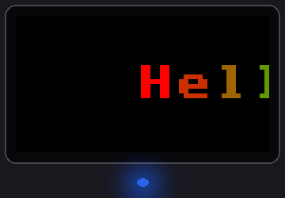

# Barrette ESP32-S3 — écran animé en MicroPython

🇬🇧 [English version](README.md)



*Aperçu généré par simulation sur PC avec le code des scènes (pas un film de la vraie carte : la cadence et les couleurs réelles peuvent différer un peu).*

Une barrette à cheveux (ou un badge, un porte-clés…) qui affiche des animations, des messages et des images sur un petit écran IPS, avec une LED RGB qui suit l'ambiance. Tout se règle depuis le téléphone, sans câble ni ordinateur.

- **Matériel :** Waveshare **ESP32-S3-LCD-1.47B** (écran ST7789 172×320, LED WS2812, USB-C, 8 Mo de PSRAM, 16 Mo de flash)
- **Logiciel :** MicroPython 1.29 (variante `ESP32_GENERIC_S3-SPIRAM_OCT`), aucun firmware spécial
- **Langue :** interface et commentaires en français

## Fonctionnalités

- **17 scènes** : texte défilant, texte fixe, arc-en-ciel, plasma, étoiles, pluie numérique, cœurs, synthwave, égaliseur, ondes néon, paillettes, vagues, feux d'artifice, spirographe, texte glitch, néon, dancefloor, plus la galerie d'images et la lecture d'animations.
- **LED WS2812** : un effet par scène (respiration, battement, scintillement, arc-en-ciel…), réglable.
- **Page web de réglages** : message, scène, luminosité écran et LED, envoi et suppression d'images (la conversion se fait dans le navigateur du téléphone).
- **Connexion facile** : au démarrage la carte affiche un **QR code** qui fait rejoindre son Wi-Fi, puis un deuxième QR qui ouvre la page. Portail captif intégré.
- **Économie d'énergie** (batterie 200 mAh) : Wi-Fi qui s'éteint tout seul, fréquence du processeur et cadence d'images réglables, puissance d'émission Wi-Fi réduite.
- **Bouton BOOT** : appui court = scène suivante ; appui long (1,5 s) = Wi-Fi on/off.

## Démarrage rapide

1. **Flasher MicroPython** (une fois) : télécharge le `.bin` `ESP32_GENERIC_S3-SPIRAM_OCT` sur [micropython.org/download/ESP32_GENERIC_S3](https://micropython.org/download/ESP32_GENERIC_S3/). Mets la carte en mode téléchargement (BOOT maintenu au branchement) et installe-le avec Thonny (*Exécuter → Configurer l'interpréteur → Installer MicroPython*) ou avec `esptool`.
2. **Copier les fichiers** `.py` du dépôt à la racine de la carte (Thonny : *Affichage → Fichiers → Téléverser*). Ne copie pas le dossier `tools/`.
3. **Tester l'écran** : lance `test_ecran.py` (barres rouge, vert, bleu, blanc et cadre blanc). Teste la LED avec `test_led.py`.
4. **Réglages personnels** : copie `config_local.example.py` en `config_local.py`, change au minimum `AP_PASSWORD`, puis téléverse-le sur la carte.
5. Au prochain redémarrage, `main.py` se lance tout seul.

## Réglages (`config.py` et `config_local.py`)

`config.py` contient les valeurs par défaut commentées. Ce que tu changes sert dans `config_local.py` (ignoré par git, donc ton mot de passe ne part pas sur GitHub).

| Réglage | Rôle |
|---|---|
| `PINS` | Brochage de l'écran. **ESP32-S3-LCD-1.47B : `bl=46`**. Le modèle USB-A d'origine utilise `bl=48`. |
| `ROTATION` | 1 = paysage, 3 = paysage retourné, 0/2 = portrait |
| `INVERT`, `BGR` | Corrigent les couleurs en négatif ou rouge/bleu inversés |
| `LED_PIN`, `LED_COUNT`, `LED_ORDER` | LED WS2812 (GPIO 38 ; ordre `"GRB"` sur la carte testée) |
| `CPU_MHZ`, `FRAME_MS` | Fréquence du processeur et cadence d'images (économie d'énergie) |
| `WEB`, `WIFI_AT_BOOT`, `WIFI_AUTO_OFF`, `WIFI_MAX_CLIENTS` | Comportement du Wi-Fi |
| `AP_SSID`, `AP_PASSWORD` | Nom et mot de passe du Wi-Fi de la barrette |
| `WIFI_RANDOM_PASSWORD`, `SHOW_PASSWORD` | Mot de passe aléatoire à chaque activation ; l'afficher en clair |
| `PLAYLIST` | La liste des scènes, dans l'ordre |

La playlist est une simple liste Python :

```python
PLAYLIST = [
    Scroll("Joyeux anniversaire !", color=PINK, scale=8, speed=180),
    Synthwave(duration=12),
    Neon("Hello", color=(255, 40, 170), duration=8),
    Gallery(seconds=6),                       # diaporama des images envoyées
    leds(Hearts(duration=8), "beat", (255, 0, 100), 140),   # même scène, effet LED choisi
]
```

`leds(scène, effet, couleur, paramètre)` choisit l'effet de la LED pour une scène ; la liste des effets (`pulse`, `beat`, `rainbow`, `twinkle`, `chase`, `glitch`, `solid`, `off`) est en commentaire en haut de `led.py`.

## Créer une scène

Une scène est un objet avec `start(d, S)` et `frame(d, S, t)`. `d` est l'écran (un `framebuf` MicroPython : `fill`, `fill_rect`, `text`, `line`, `ellipse`…), `S` les réglages, `t` le temps en ms. Retourne `True` pour finir. Copie une classe de `scenes.py` ou `scenes_fx.py` et modifie `frame()`.

## Envoyer des images

Page web → section **Images** → choisis des photos. Elles sont redimensionnées et converties en RGB565 par le navigateur, envoyées par morceaux de 8 Ko, et enregistrées dans `images/`. Chaque image occupe environ 110 Ko. Les GIF animés ne sont pas pris en charge : utilise `tools/gif2raw.py` et la scène `Anim`.

## Wi-Fi, QR code et sécurité

- Le Wi-Fi de la barrette est **chiffré (WPA2)**. Le QR affiché contient le mot de passe : il suffit de le scanner pour rejoindre le réseau. Toute personne qui voit l'écran à ce moment peut donc le scanner.
- **Change `AP_PASSWORD`.** La valeur par défaut est publique dans ce dépôt.
- `WIFI_MAX_CLIENTS` limite le nombre d'appareils connectés. `WIFI_AT_BOOT = False` ne démarre le Wi-Fi qu'après un appui long sur BOOT. `WIFI_RANDOM_PASSWORD = True` change le mot de passe à chaque activation.
- Le portail captif fait répondre la carte à toutes les adresses ; selon le téléphone, la page s'ouvre toute seule, par une notification « Se connecter au réseau », ou avec le deuxième QR. Les messages de diagnostic sont dans la console (`DEBUG` dans `web.py`).
- Le générateur de QR (`qr.py`) est écrit pour MicroPython (mode octets, correction M, jusqu'à 106 octets). Ses matrices sont identiques à celles de la bibliothèque Python `qrcode`.

## Batterie

La carte accepte une LiPo 3,7 V (connecteur sur le header, vérifier la polarité). Pour tenir deux heures avec 200 mAh : éteindre le Wi-Fi (c'est automatique), baisser la luminosité de l'écran (30–40 %) et de la LED (10–15 %), `CPU_MHZ = 80`, privilégier une image fixe ou des scènes calmes. Les chiffres de consommation sont à mesurer avec un testeur USB-C. Vérifie aussi le courant de charge de la carte par rapport à la capacité de ta batterie.

## Outils (sur PC, dans `tools/`)

- `gif2raw.py` : convertit un GIF en images `.raw` pour la scène `Anim`.
- `qr_wifi.py` : fabrique un QR du Wi-Fi à imprimer (lit `AP_SSID` et `AP_PASSWORD` dans `config.py` et `config_local.py`). `pip install qrcode pillow`.

## Structure

```
main.py            démarrage, lecteur de scènes, bouton, Wi-Fi, QR
config.py          réglages par défaut (+ config_local.py pour les tiens)
display.py         pilote ST7789 en MicroPython pur (framebuffer RGB565)
gfx.py             couleurs, palette, texte agrandi
scenes.py          scènes de base      scenes_fx.py   scènes electro / rétro / galerie
led.py             LED WS2812 et effets
web.py             serveur web, portail captif (DNS), envoi d'images
qr.py              générateur de QR code
test_ecran.py  test_led.py  tools/
```

## Limites connues

- La police intégrée est en ASCII : les accents sont remplacés (é → e).
- Les animations sont calculées en Python : les scènes les plus lourdes tournent à quelques dizaines d'images par seconde au mieux.
- Testé sur une seule carte (ESP32-S3-LCD-1.47B). Le brochage d'autres variantes peut différer.

## Licence

MIT, voir `LICENSE`.
