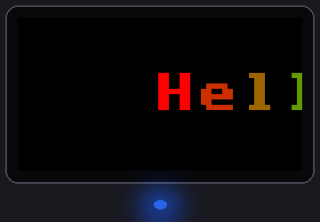

# ESP32-S3 Animated Hair Barrette — MicroPython

🇫🇷 [Version française](README.fr.md)



*Preview generated by simulating the scene code on a PC (not a video of the real board: actual frame rate and colours may differ slightly).*

A hair barrette (or badge, keychain…) that shows animations, messages and images on a small IPS screen, with an RGB LED that follows the mood. Everything is configured from a phone: no cable, no computer.

- **Hardware:** Waveshare **ESP32-S3-LCD-1.47B** (ST7789 172×320 screen, WS2812 LED, USB-C, 8 MB PSRAM, 16 MB flash)
- **Software:** MicroPython 1.29 (`ESP32_GENERIC_S3-SPIRAM_OCT` build), no custom firmware
- **License:** MIT

## Features

- **17 scenes**: scrolling text, static text, rainbow, plasma, stars, digital rain, hearts, synthwave, equalizer, neon rings, sparkles, waves, fireworks, spirograph, glitch text, neon sign, dancefloor, plus an image gallery and animation playback.
- **WS2812 LED**: one effect per scene (breathing, beat, twinkle, rainbow…), adjustable.
- **Web settings page**: message, scene, screen and LED brightness, image upload and deletion (images are converted in the phone's browser).
- **Easy connection**: at startup the board shows a **QR code** that joins its Wi-Fi, then a second QR that opens the page. Built-in captive portal.
- **Power saving** (200 mAh battery): Wi-Fi turns itself off, adjustable CPU frequency and frame rate, reduced Wi-Fi transmit power.
- **BOOT button**: short press = next scene; long press (1.5 s) = Wi-Fi on/off.

## Quick start

1. **Flash MicroPython** (once): download the `ESP32_GENERIC_S3-SPIRAM_OCT` `.bin` from [micropython.org/download/ESP32_GENERIC_S3](https://micropython.org/download/ESP32_GENERIC_S3/). Put the board in download mode (hold BOOT while plugging it in) and install it with Thonny (*Run → Configure interpreter → Install MicroPython*) or with `esptool`.
2. **Copy the `.py` files** from this repository to the root of the board (Thonny: *View → Files → Upload to /*). Do not copy the `tools/` or `docs/` folders.
3. **Test the screen**: run `test_ecran.py` (red, green, blue, white bars and a white frame). Test the LED with `test_led.py`.
4. **Personal settings**: copy `config_local.example.py` to `config_local.py`, change at least `AP_PASSWORD`, and upload it to the board.
5. On the next reboot, `main.py` starts by itself.

## Settings (`config.py` and `config_local.py`)

`config.py` holds the commented defaults. Put your own values in `config_local.py` (ignored by git, so your password never reaches GitHub).

| Setting | Purpose |
|---|---|
| `PINS` | Screen wiring. **ESP32-S3-LCD-1.47B: `bl=46`**. The original USB-A model uses `bl=48`. |
| `ROTATION` | 1 = landscape, 3 = flipped landscape, 0/2 = portrait |
| `INVERT`, `BGR` | Fix negative colours or swapped red/blue |
| `LED_PIN`, `LED_COUNT`, `LED_ORDER` | WS2812 LED (GPIO 38; `"GRB"` order on the tested board) |
| `CPU_MHZ`, `FRAME_MS` | CPU frequency and frame interval (power saving) |
| `WEB`, `WIFI_AT_BOOT`, `WIFI_AUTO_OFF`, `WIFI_MAX_CLIENTS` | Wi-Fi behaviour |
| `AP_SSID`, `AP_PASSWORD` | Name and password of the barrette's Wi-Fi |
| `WIFI_RANDOM_PASSWORD`, `SHOW_PASSWORD` | New random password at each activation; show it in clear text |
| `PLAYLIST` | The list of scenes, in order |

The playlist is a plain Python list:

```python
PLAYLIST = [
    Scroll("Happy birthday!", color=PINK, scale=8, speed=180),
    Synthwave(duration=12),
    Neon("Hello", color=(255, 40, 170), duration=8),
    Gallery(seconds=6),                       # slideshow of the uploaded images
    leds(Hearts(duration=8), "beat", (255, 0, 100), 140),   # same scene, chosen LED effect
]
```

`leds(scene, effect, color, parameter)` picks the LED effect for a scene. The effects (`pulse`, `beat`, `rainbow`, `twinkle`, `chase`, `glitch`, `solid`, `off`) are listed in a comment at the top of `led.py`.

## Writing a scene

A scene is an object with `start(d, S)` and `frame(d, S, t)`. `d` is the screen (a MicroPython `framebuf`: `fill`, `fill_rect`, `text`, `line`, `ellipse`…), `S` the settings and `t` the time in ms. Return `True` to finish. Copy a class from `scenes.py` or `scenes_fx.py` and edit `frame()`.

## Uploading images

Web page → **Images** section → pick photos. They are resized and converted to RGB565 by the browser, sent in 8 KB chunks and stored in `images/`. Each image takes about 110 KB. Animated GIFs are not supported directly: use `tools/gif2raw.py` and the `Anim` scene.

## Wi-Fi, QR code and security

- The barrette's Wi-Fi is **encrypted (WPA2)**. The displayed QR contains the password: scanning it is enough to join. Anyone who can see the screen at that moment can scan it.
- **Change `AP_PASSWORD`.** The default value is public in this repository.
- `WIFI_MAX_CLIENTS` limits the number of connected devices. `WIFI_AT_BOOT = False` only starts Wi-Fi after a long press on BOOT. `WIFI_RANDOM_PASSWORD = True` changes the password at every activation.
- The captive portal makes the board answer every address; depending on the phone, the page opens by itself, through a "Sign in to network" notification, or with the second QR. Diagnostic messages go to the console (`DEBUG` in `web.py`).
- The QR generator (`qr.py`) is written for MicroPython (byte mode, ECC M, up to 106 bytes). Its matrices are identical to those of the Python `qrcode` library.

## Battery

The board accepts a 3.7 V LiPo (header connector, check polarity). To last a couple of hours on 200 mAh: let Wi-Fi turn itself off (automatic), lower screen brightness (30–40 %) and LED brightness (10–15 %), set `CPU_MHZ = 80`, and favour a still image or calm scenes. Measure real consumption with a USB-C power meter, and check the board's charge current against your battery's capacity.

## PC tools (in `tools/`)

- `gif2raw.py`: converts a GIF into `.raw` frames for the `Anim` scene.
- `qr_wifi.py`: makes a printable Wi-Fi QR (reads `AP_SSID` and `AP_PASSWORD` from `config.py` and `config_local.py`). `pip install qrcode pillow`.

## Layout

```
main.py            startup, scene player, button, Wi-Fi, QR
config.py          default settings (+ config_local.py for yours)
display.py         pure-MicroPython ST7789 driver (RGB565 framebuffer)
gfx.py             colours, palette, scaled text
scenes.py          basic scenes        scenes_fx.py   electro / retro scenes, gallery
led.py             WS2812 LED and effects
web.py             web server, captive portal (DNS), image upload
qr.py              QR code generator
test_ecran.py  test_led.py  tools/  docs/
```

## Known limitations

- The built-in font is ASCII only: accents are replaced (é → e).
- Animations are computed in Python: the heaviest scenes reach a few tens of frames per second at best.
- Tested on a single board (ESP32-S3-LCD-1.47B). Pinouts of other variants may differ.
- Code comments and the web interface are in French.

## License

MIT, see `LICENSE`.
